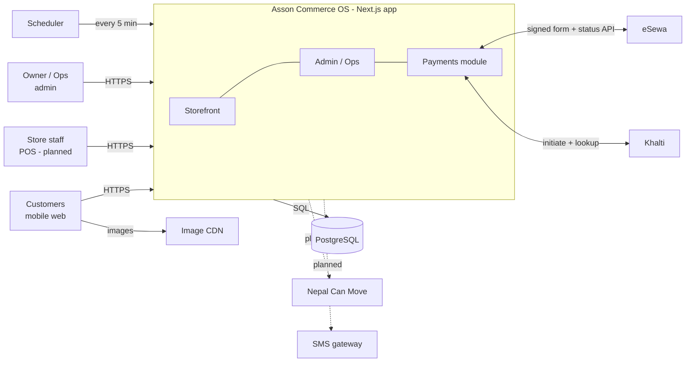
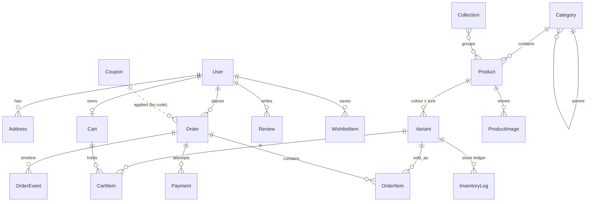
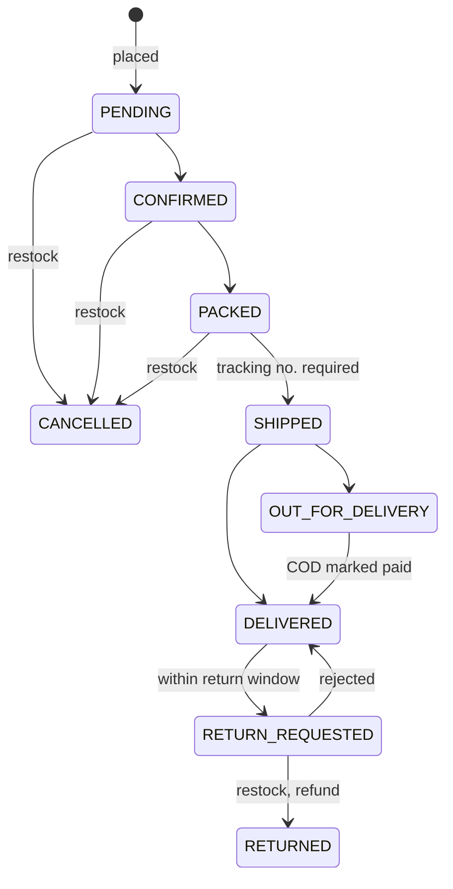

# Asson — Architecture

| | |
|---|---|
| **Scope** | Asson Commerce OS: storefront, admin and operations, payments, and planned POS |
| **Status** | v1.0, 9 Nov 2026. Describes the system as built, plus the planned path |
| **Read with** | [PRD](PRD.md) for *what* and *why* · [Rules](Rules.md) for *how we write code* |

---

## 1. Principles

1. **One source of truth.** PostgreSQL holds orders, stock, payments and customers. Nothing else is a ledger.
2. **Correct before fast before pretty.** Money and stock are written in transactions with conditional updates. Pages are cached. Design comes last.
3. **Server is the authority.** Prices, discounts, delivery fees, stock and payment status are always computed or verified on the server. The browser only sends IDs and choices.
4. **Append, don't overwrite.** Stock moves through a ledger (`InventoryLog`). Orders move through a state machine with an event log (`OrderEvent`). Payments are attempts (`Payment`). Nothing financial is deleted.
5. **Boring, proven stack.** One deployable app (a modular monolith). Split into services only when a measured bottleneck demands it.
6. **Built for Nepal.** NPR in paisa, Asia/Kathmandu time, 77 districts and delivery zones, COD-first, eSewa and Khalti.

## 2. System context



## 3. Tech stack

| Layer | Choice | Version | Why |
|---|---|---|---|
| Framework | **Next.js** (App Router, Server Components, Server Actions, Turbopack) | 16.4.5 | One codebase for storefront, admin and API; streaming SSR; strong SEO |
| UI runtime | **React** | 19.3 | `useActionState`, `useOptimistic`, transitions |
| Language | **TypeScript** (strict) | 5.x | Type safety end to end |
| Styling | **Tailwind CSS** v4 with tokens in `globals.css` | 4.x | Design tokens, no CSS sprawl |
| Database | **PostgreSQL** | 15+ | Transactions, row locks, full-text and trigram search, JSONB |
| ORM | **Prisma** (`prisma-client-js`) | 6.19 | Typed queries, migrations. Pinned to 6.x; v7/v8 change the client model |
| Validation | **zod** | 4.x | One schema per boundary |
| Auth | **jose** (JWT, HS256) + **bcryptjs** (cost 12) | — | Stateless, edge-safe sessions; revocable via `tokenVersion` |
| Icons / toasts | **lucide-react** · **sonner** | — | Consistent stroke icons; accessible toasts |
| Fonts | **Fraunces** (display) · **Inter** (UI) via `next/font` | — | Self-hosted, no layout shift |
| Payments | eSewa ePay v2 · Khalti KPG-2 (direct HTTP, no SDKs) | — | No unvetted dependencies on the money path |

**Not used, on purpose:** Redux or Zustand (server state lives on the server; the client uses context and transitions), an ORM other than Prisma, CSS-in-JS, component kits we don't control, client-side price maths.

## 4. Logical modules

The [PRD](PRD.md) defines ten business systems. They map onto the codebase like this:

| System | Responsibility | Lives in | Status |
|---|---|---|---|
| Commerce | Catalogue, search, cart, checkout | `lib/catalog.ts`, `lib/cart.ts`, `actions/cart.ts`, `actions/checkout.ts`, `app/(shop)` | ✅ |
| Payments | eSewa, Khalti, COD, reconciliation | `lib/payments/*`, `app/api/payments/*`, `app/api/cron/payments` | 🟡 |
| Orders and fulfilment | State machine, events, packing slip | `lib/orders.ts`, `lib/order-status.ts`, `actions/admin/orders.ts` | ✅ |
| Inventory | Variant stock, ledger, adjustments | `Variant`, `InventoryLog`, `actions/admin/catalog.ts` | ✅ (no costing yet) |
| Customers | Accounts, addresses, wishlist, reviews | `lib/auth.ts`, `actions/account.ts`, `actions/auth.ts` | ✅ |
| Workforce | Roles, permissions, approval PINs | `lib/permissions.ts` (single map), `requirePermission()` | ✅ |
| POS | In-store selling, shifts, daily closing | `lib/pos.ts`, `actions/pos.ts`, `components/pos/`, `app/admin/pos`, `app/admin/closing` | ✅ core; returns ⬜ |
| Procurement | Suppliers, POs, goods receipt, landed and weighted-average costing, reorder suggestions | `actions/admin/purchasing.ts`, `lib/costing.ts`, `app/admin/purchasing`, `app/admin/suppliers` | ✅ |
| Finance | P&L, profit by product, stock valuation, expenses | `lib/finance.ts`, `actions/admin/finance.ts`, `app/admin/finance` | ✅ |
| Returns | Store returns and exchanges, store credit | `actions/returns.ts`, `components/pos/return-panel.tsx` | ✅ |
| Shipping | NCM integration | — | ⬜ Phase 6 |
| Reporting | Dashboard, daily closing | `app/admin/page.tsx` | 🟡 |

## 5. Folder structure

```
.
├── docs/                    # PRD, Architecture, Rules, Phases, Design, Memory (this folder)
├── prisma/
│   ├── schema.prisma        # data model (single source of truth for tables)
│   ├── migrations/          # SQL migrations; review every generated file
│   └── seed.ts              # DEV ONLY demo data. Wipes the DB; refuses in production
├── public/
└── src/
    ├── proxy.ts             # optimistic auth gate for /account and /admin (Next 16 "proxy" = middleware)
    ├── app/
    │   ├── layout.tsx       # root: fonts, metadata, toaster
    │   ├── globals.css      # design tokens (@theme) + base styles
    │   ├── (shop)/          # storefront route group (shared header, footer, bag)
    │   │   ├── page.tsx                 home
    │   │   ├── shop/ c/[slug]/ collections/[slug]/   listing + search
    │   │   ├── p/[slug]/                product page
    │   │   ├── cart/ checkout/ pay/[orderId]/        buying
    │   │   ├── orders/[id]/ track/      order status
    │   │   ├── account/…                customer area
    │   │   └── login/ register/ help/ size-guide/
    │   ├── admin/           # operations panel (staff only)
    │   │   ├── page.tsx                 dashboard
    │   │   ├── orders/ products/ inventory/ customers/ coupons/ reviews/
    │   │   └── orders/[id]/slip/        printable packing slip
    │   └── api/
    │       ├── search/suggest/          instant search (cached, rate-limited)
    │       ├── payments/esewa|khalti/   provider return URLs
    │       └── cron/payments/           reconciliation + expiry (Bearer CRON_SECRET)
    ├── actions/             # "use server" mutations, grouped by domain
    │   └── admin/           # staff-only mutations (role-checked inside)
    ├── components/
    │   ├── ui/              # primitives: Button, Input, Field, Select, Sheet, Badge, Price, Stars, DistrictSelect
    │   ├── site/            # header, mega nav, search, footer, ShopProvider
    │   ├── product/ catalog/ cart/ account/ admin/
    └── lib/                 # server-side domain logic (most files import "server-only")
        ├── config.ts        # ALL business settings: brand, currency, zones, fees, COD limit, returns, provinces
        ├── db.ts auth.ts session-token.ts rate-limit.ts
        ├── catalog.ts       # listing, facets, search, product queries (cached)
        ├── cart.ts pricing.ts validators.ts
        ├── delivery.ts      # loads per-district rates (server, cached)
        ├── delivery-shared.ts # client-safe: rateFor, deliveryFee, etaLabel, etaDate
        ├── orders.ts order-status.ts order-access.ts
        ├── payments/        # index.ts (service), esewa.ts, khalti.ts
        ├── image-loader.ts  # CDN resizing
        └── utils.ts         # formatPrice, dates, addressLines, slugify …
```

**Dependency direction:** `app` → `actions` → `lib` → `db`. Components never import `db`. `lib` never imports from `app` or `components`. Client components import only `lib/config`, `lib/utils`, `lib/order-status` and types.

## 6. Data model



| Entity | Notes |
|---|---|
| `Product` | Price and MRP in paisa; `status` DRAFT, ACTIVE or ARCHIVED; denormalised `ratingAvg`, `ratingCount` and `soldCount` for fast sorting |
| `Variant` | **The stock-keeping unit.** Unique `sku`; unique (product, colour, size); `stock` is the live balance |
| `InventoryLog` | Signed `delta` plus `reason` (SALE, CANCEL_RESTOCK, RETURN_RESTOCK, RECEIVED, MANUAL_ADJUST, DAMAGED), actor and order. The history behind `stock` |
| `Order` | Autoincrement `number` shown as `AS000123`; totals snapshot; `shippingAddress` JSON snapshot (with `district` and `zone`); `paymentMethod` COD or ONLINE; `paymentProvider`; `paymentDueAt` |
| `OrderItem` | **Snapshot** of name, SKU, colour, size, image and unit price at purchase. Catalogue edits never rewrite history |
| `OrderEvent` | Append-only timeline with actor (email, `system` or `guest`) |
| `Store` / `Shift` / `Tender` / `DayClose` | POS: a shop; a cashier session with opening float and counted cash; how a store sale was paid (split allowed, cash `tendered` for change); the locked end-of-day snapshot (unique per store and date) |
| `Order.channel` | ONLINE or STORE. Store sales are orders with `paymentMethod IN_STORE`, status DELIVERED, plus `cashierId`, `shiftId`, `discountReason`, `discountApprovedById` and an idempotency `clientRef` |
| `Payment` | One row per online attempt. `reference` (ours) is unique; `providerRef` (Khalti pidx); `providerTxn`; status INITIATED, COMPLETED, FAILED or AMBIGUOUS; raw provider payload |
| `Address` | District (77), province (derived), city, tole (`line1`), landmark (`line2`), optional postal code |
| `DeliveryRate` | One row per district: fee (paisa), ETA min/max days, express, COD, serviceable. Read via cached `getDeliveryRates()` (tag `delivery`); missing rows fall back to the zone defaults in `config.ts` |

**Indexes worth knowing:** status+category, status+price, status+createdAt, status+soldCount; GIN full-text on `product_search_doc(...)` (raw SQL migration); GIN trigram on `Product.name` (declared in schema); `Order(paymentStatus, paymentDueAt)` for the expiry job.

| `Variant.costPrice` / `OrderItem.unitCost` | Weighted-average cost (owner-only) and the cost snapshotted on each sale line, so profit never changes retroactively |
| `Return` / `ReturnItem` | Store return against any delivered order: lines with condition (RESELLABLE restocks, DAMAGED quarantined), refund method, approver, voucher code, idempotency `clientRef` |
| `Coupon.isCredit` | Store credit: `value` is a balance drawn down at the till (VOUCHER tender) or online checkout; deactivated at 0 |
| `Supplier` / `PurchaseOrder` / `PurchaseOrderItem` / `GoodsReceipt` / `GoodsReceiptItem` | Procurement: ordered vs received vs damaged per line; landed unit cost recorded per receipt |
| `Expense` | Dated, categorised, append-only (corrections are negative entries) |

| `Store` / `StoreStock` | Locations (shops with tills, warehouses) and units per location. `Variant.stock` = Σ `StoreStock.quantity`, maintained by trigger `store_stock_sync`; `variant_stock_guard` rejects direct writes; `quantity >= 0` check. All changes go through `lib/stock.ts` (conditional decrement + `InventoryLog` row with `storeId`) |
| `OrderAllocation` | Where each sold unit came from (location, quantity, picked at/by). Online checkout ranks locations: preferred (pickup shop) → the one that can fill the most lines → priority, splitting a line when needed. Till sales are allocated and picked at the till's shop. Cancels/returns restock to the same locations |
| `StockTransfer` / `StockTransferItem` | DRAFT → SENT (TRANSFER_OUT at source) → RECEIVED (TRANSFER_IN of counted units; TRANSFER_LOSS row for any shortfall, note required) or CANCELLED (a recall puts sent units back). Status moves are conditional updates |

**Planned tables:** `SupplierBill` / `SupplierPayment`, `StockCount`, `Shipment` (NCM).

## 7. Key flows

### 7.1 Checkout (race-safe stock reservation)

```mermaid
sequenceDiagram
    participant B as Browser
    participant A as placeOrder (server action)
    participant DB as PostgreSQL
    B->>A: IDs + address + method + coupon code
    A->>A: zod validate · rate limit · load cart · recompute totals (zone fee, coupon)
    A->>DB: BEGIN
    A->>DB: increment coupon usage WHERE usedCount < limit
    A->>DB: INSERT Order + OrderItems (snapshot) + OrderEvent
    loop each line, locations in ranked order (allocateOrder)
      A->>DB: UPDATE StoreStock SET quantity = quantity - q WHERE storeId = ? AND variantId = ? AND quantity >= q
      Note over A,DB: trigger keeps Variant.stock = Σ locations; a line no location can fill → ROLLBACK, "just sold out"
      A->>DB: INSERT OrderAllocation + InventoryLog(storeId)
    end
    A->>DB: clear cart · COMMIT
    A-->>B: redirect to /orders/:id (COD) or /pay/:id?provider=… (online)
```

### 7.2 Online payment

```mermaid
sequenceDiagram
    participant B as Browser
    participant P as /pay/:orderId
    participant G as eSewa / Khalti
    participant R as return route
    participant DB as PostgreSQL
    B->>P: open (plain link, never prefetched)
    P->>DB: create Payment(reference, amount = order.total)
    alt eSewa
      P-->>B: auto-POST HMAC-signed form
    else Khalti
      P->>G: POST /epayment/initiate (server-to-server)
      P-->>B: 302 to payment_url
    end
    B->>G: customer pays
    G-->>B: redirect to our return URL
    B->>R: GET with data / pidx
    R->>G: verify (eSewa signature, else status API; Khalti lookup always)
    R->>DB: settlePaid (idempotent; amount must equal order total)
    R-->>B: /orders/:id?paid=1
    Note over DB: Cron every 5 min reconciles stale attempts, then cancels and restocks unpaid orders
```

### 7.3 Order lifecycle



Transitions are defined once in `lib/order-status.ts` and applied by `transitionOrder()` with optimistic concurrency (`UPDATE … WHERE status = <expected>`).

## 8. Cross-cutting concerns

### 8.1 Rendering and caching

- `cacheComponents` is **off** (classic model). Pages render per request; hot reads use `unstable_cache` with tags:
  - `products`: listings, facets, product pages, rails, suggestions (60 s – 5 min, busted on admin edits via `revalidateTag("products", …)`)
  - `catalog`: category tree, collections (1 h)
  - `delivery`: per-district delivery rates (1 h, busted on save in Admin → Delivery rates)
- Live stock on the product page is always read fresh (`getLiveStock`).
- Mutations call `refresh()` (Next 16) or `revalidatePath` so the header bag and pages update.
- Images use a custom loader (`lib/image-loader.ts`), so our servers never resize photos at request time.
- **Uploaded photos** (admin product editor): the browser resizes each photo to 480/960/1600 px WebP (JPEG where WebP encoding is unavailable) and posts them to `POST /api/admin/media` (owner only, same-origin). The server verifies format and dimensions from the bytes (`lib/image-probe.ts`; never SVG/HTML), stores them content-addressed and immutable under `MEDIA_DIR/p/<hash>-<w>.<ext>` with a `MediaAsset` row, and serves them from `/media/…` with a one-year immutable cache so Cloudflare serves repeat views. Products store `/media/p/<hash>.webp`; the loader picks the smallest stored width that covers the request; feeds, JSON-LD and OG use `absoluteImageUrl` (1600 px). Storage is local disk plus nightly off-site copy; moving to object storage means re-implementing `lib/media.ts` only.

### 8.2 Auth and authorisation

- Session is a signed JWT in the httpOnly cookie `tl_session` (30 days), containing `{sub, role, v}`.
- `getCurrentUser()` checks the token against the DB **and** `tokenVersion`. Bumping the version signs the user out everywhere (password change, role change).
- Authorisation is **permission-based**: `lib/permissions.ts` maps CASHIER, STAFF, MANAGER and ADMIN to permissions (`pos.sell`, `orders`, `closing`, `approve.discount`, `catalog.edit`, `delivery`, …). Pages and actions call `requirePermission(p)`; the admin menu filters with `can(role, p)`. Approvers authorise till discounts with a bcrypt-hashed PIN (rate-limited).
- `proxy.ts` gives a fast redirect for `/account` and `/admin`. **This is not the security boundary.** Every page and server action re-checks with `requireUser`, `requireStaff` or `requireAdmin`.
- Guest orders are reachable by unguessable cuid. Account orders are visible only to their owner and staff (`lib/order-access.ts`).

### 8.3 Money, time and locale

- Integer **paisa** everywhere (`Rs. 1 = 100`). Formatted with `formatPrice()` as `Rs. 1,49,900` (lakh grouping).
- Percentage discounts are rounded down to whole rupees.
- Times are stored in UTC and displayed in `Asia/Kathmandu` (dashboard SQL uses the same zone).

### 8.4 Configuration

| Variable | Purpose |
|---|---|
| `DATABASE_URL` | PostgreSQL connection (use a pooled URL in production) |
| `AUTH_SECRET` | ≥ 32 random chars; signs sessions |
| `NEXT_PUBLIC_SITE_URL` | Canonical URL; builds payment return URLs |
| `ESEWA_ENV`, `ESEWA_PRODUCT_CODE`, `ESEWA_SECRET_KEY` | eSewa (`test` uses the rc-epay UAT) |
| `KHALTI_ENV`, `KHALTI_SECRET_KEY` | Khalti (`test` uses dev.khalti.com) |
| `CRON_SECRET` | Bearer token for `/api/cron/payments` |

Business settings (free-delivery threshold, express fee, default zone rates, COD limit, return window, brand, `onlinePaymentsLive`) live in `src/lib/config.ts`. Per-district delivery prices live in the `DeliveryRate` table and are edited in the admin.

### 8.5 Testing

| Layer | Tool | Scope | Command |
|---|---|---|---|
| Unit | Vitest | Pure rules: pricing, delivery, costing, refunds, barcode, permissions, state machine, validators | `npm run test:unit` |
| Integration | Vitest + Postgres `asson_test` | Real server actions with mocked Next request APIs (`tests/support/next-mocks.ts`): POS, returns, purchasing, checkout, notifications, COD | `npm run test:int` |
| End-to-end | Playwright (local Chrome) | Production build on :3100 with a freshly seeded `asson_e2e` database | `npm run test:e2e` |
| CI | GitHub Actions | typecheck → lint → unit → integration → build → E2E | `.github/workflows/ci.yml` |

### 8.6 Notifications (outbox)

Customer SMS rows are written in the same transaction as the order event (`queueOrderNotice`), then `dispatchNotifications()` sends them after the response (`after()`) and from `/api/cron/notifications`. Claims use a conditional update so concurrent dispatchers never double-send. Provider is set by `NOTIFY_SMS_PROVIDER`; in production with none set, messages wait in the queue.

### 8.7 Errors and observability

- Server actions return `{ ok, error, fieldErrors }` for expected failures and log unexpected ones with context.
- Route segments have `error.tsx` and `not-found.tsx`.
- **Planned:** Sentry (errors), OpenTelemetry traces, uptime check on `/` and `/api/search/suggest`, alerts when the reconciliation job holds AMBIGUOUS payments.

## 9. Deployment

**Recommended production topology**

```
Cloudflare (DNS, WAF, CDN)  →  App: Vercel or 2+ Node containers (region: Mumbai ap-south-1 or Singapore)
                                  │
                                  ├─ PostgreSQL (managed: Neon / Supabase / RDS) + PgBouncer pooling + PITR backups
                                  ├─ Redis (Upstash) for shared rate limits, when running more than one instance
                                  ├─ Image CDN (Cloudinary / ImageKit / S3 + CloudFront) for product photos
                                  └─ Scheduler (Vercel Cron / GitHub Actions / cron) → /api/cron/payments every 5 min
```

**Release process:** PR → CI (`typecheck`, `lint`, `build`) → `prisma migrate deploy` → deploy → smoke test (home, product, checkout to the payment page, admin).

**Environments:** `development` (local Postgres, eSewa UAT) → `staging` (mirrors prod, provider test keys) → `production`.

## 10. Scaling path

| Trigger | Action |
|---|---|
| > 1 app instance | Move `lib/rate-limit.ts` to Redis (same interface) |
| DB CPU > 60% at peak | Read replica for listings and reports; check `pg_stat_statements` |
| > 100k variants or richer search needs | Sync products to Meilisearch or Typesense; keep Postgres as truth |
| POS + multiple stores | Add `Store` and `Register`; stock per location (`VariantStock(storeId, variantId)`) |
| Heavy background work (SMS, NCM, feeds) | Job queue (e.g. a Postgres-backed queue) with idempotent workers |
| Native app | Expose the same domain logic through route handlers; no business logic in clients |

## 11. Architecture decision records

| # | Decision | Reason | Revisit when |
|---|---|---|---|
| ADR-1 | Modular monolith on Next.js | Small team; one deploy; shared types | Independent scaling needs appear |
| ADR-2 | Prisma **6.x** (not 7 or 8) | Stable, well-known client; 7+ change config and drivers | After the v1 launch |
| ADR-3 | `cacheComponents: false` | Pages read cookies (bag, user) everywhere; explicit `unstable_cache` is simpler and predictable | Next's cache model stabilises for this pattern |
| ADR-4 | Postgres FTS + trigram for search | No extra infra; handles typos, colours and gender words | > 100k products or a faceted-search need |
| ADR-5 | JWT session + `tokenVersion` | Stateless and edge-safe, yet revocable | Need device-level session management |
| ADR-6 | Money as integer paisa | No floating-point errors | Never |
| ADR-7 | Direct HTTP to eSewa and Khalti, no SDKs | Small, auditable money path | A provider ships an official, maintained SDK |
| ADR-8 | Province derived from district | The two can never disagree | Never |
| ADR-9 | Expression index for FTS in raw SQL; trigram index declared in schema | Prisma drops indexes it doesn't know about (see Rules) | Prisma supports expression indexes |
| ADR-10 | `loading.tsx` on every dynamic storefront segment | Without a loading boundary, Next prefetches every visible link by fully rendering that page — dozens of DB-heavy renders per product view | Never (keep boundaries) |
| ADR-11 | Outbox for customer messages | Messages survive gateway outages, are retried, auditable and never double-sent | — |
| ADR-12 | Loyalty balance on `User.points` + append-only `PointsEntry` ledger | Atomic conditional spend (no double-spend under concurrency) with a full audit trail | Points expiry or multi-currency rewards are needed |
